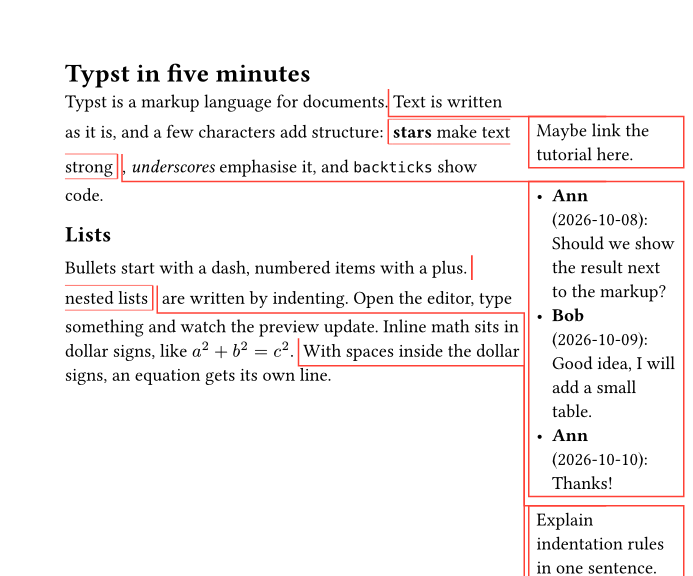
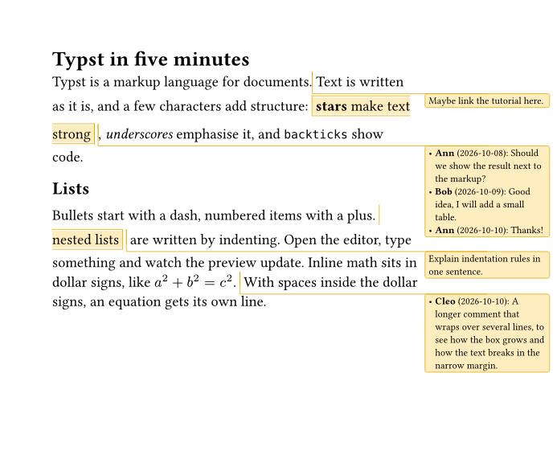
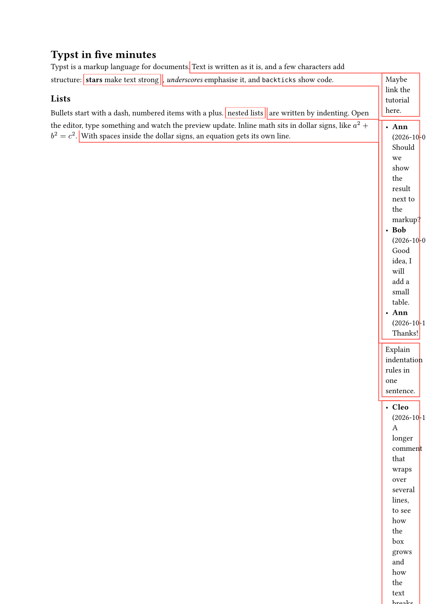
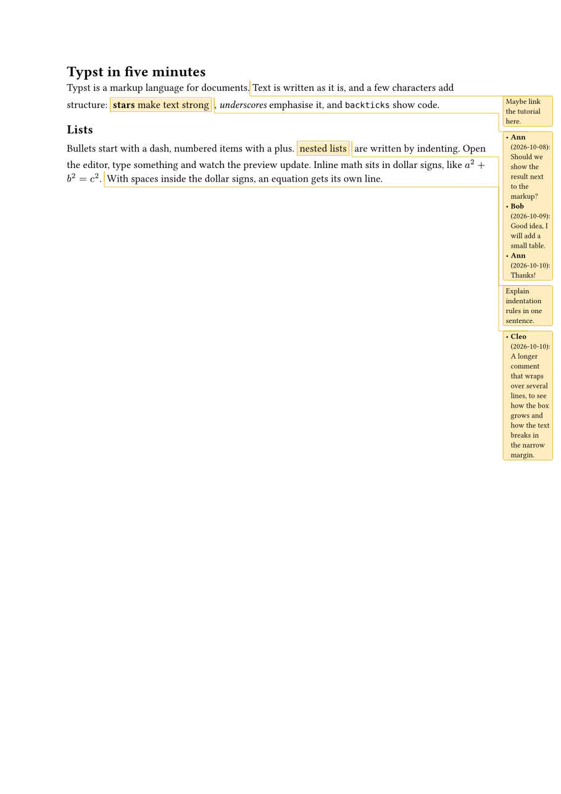

# Margin notes in the PDF: a nicer default look; PDF download with or without comments

Status: done (branch task/notes-pdf)
Depends on: comments-drafting, comment-replies (the thread format), restructure-src
Touches: crates/typst-engine (PDF export), the engine wrapper and worker protocol, add-margin-note
(preamble), the widget's preview toolbar, docs/embedding.md

## 1. A better default look of drafting notes (user, 2026-10-10)
drafting's default (a plain bordered box and a thin line) looks rough. When the editor adds the drafting import, it
also adds **one** defaults call, idempotently (like the import), e.g.:
```typst
#import "@preview/drafting:0.2.2": margin-note, set-margin-note-defaults
#set-margin-note-defaults(
  stroke: rgb("#e0a800") + 0.6pt,
  rect: (..args) => rect(fill: rgb("#fff8e0"), radius: 2pt, inset: 4pt, ..args),
)
```
- Pick the style with the typst CLI (`mise exec -- typst compile`): render samples of point notes,
  range notes and threads with replies, at the demo's page setup and at A4, and choose a calm,
  readable look: small text (~8pt), the highlight colour matching the Visual view's note colour,
  a subtle connector. Put before/after PNGs in the task Outcome.
- Check which keys drafting 0.2.2 accepts (`margin-note-defaults`: stroke, rect, side, hidden,
  margin-*, page-offset-x, fill?). Unknown keys panic.
- Never overwrite an existing `set-margin-note-defaults` call. Documents that already style their
  notes stay as they are.
- Range-note highlight: drafting's inline highlight look also gets a matching default if it is configurable.

## 2. PDF download: with comments / without comments (user, 2026-10-10)
- Engine: add PDF export to the wasm (`typst-pdf` crate, same version as typst). New API
  `exportPdf(main, options) → Uint8Array`, run in the worker like compile. Report the wasm size
  increase (raw/gzip) in the Outcome.
- **Without comments:** compile a generated wrapper entry instead of `main`, which hides every note without
  touching the document:
  ```typst
  #import "@preview/drafting:0.2.2": set-margin-note-defaults
  #set-margin-note-defaults(hidden: true)
  #include "/main.typ"
  ```
  (only when the project uses drafting). Verify that a later `set-margin-note-defaults(..)` in the
  document doesn't turn them on again. If it does, use `sys.inputs` or a show rule instead and explain.
  Range notes keep their text without the highlight. Check that `hidden` does that.
- Widget UI: a "Download PDF" button in the preview toolbar with a small menu "With comments" /
  "Without comments" (the plain button = without comments, the usual "final" version; decide and
  document). File name from the main file (`main.pdf`, `main-with-comments.pdf`).
- Host API: `editor.exportPdf({ comments: boolean }) → Promise<Blob>` (and on `<typst-editor>`), so
  hosts can save it themselves. Also a widget option to hide the button.
- Errors: if the document has compile errors, tell the user (status) and don't download a stale PDF.

## Acceptance
- vitest: engine exports a non-empty PDF (starts with `%PDF-`); the wrapper hides notes (compile
  both variants: glyph count in the margin differs, or check via a text extraction of the PDF
  if simple); the defaults call is added once and never duplicated; existing defaults untouched.
- Playwright (user-run): click Download PDF → a download event with a `.pdf` file, for both variants.

## Outcome
- **Default look** (`NOTE_STYLE` in `src/features/comments/add-margin-note.ts`): an import the
  editor adds is now `#import "@preview/drafting:0.2.2": margin-note, set-margin-note-defaults`,
  followed by one call:
  ```typst
  #set-margin-note-defaults(
    stroke: rgb("#e0a800") + 0.5pt,
    fill: rgb("#fabe1447"),
    rect: (body, ..args) => rect(radius: 2pt, inset: 3pt, ..args, {
      set text(size: 8pt)
      set list(indent: 0pt, body-indent: 0.3em)
      body
    }),
  )
  ```
  The Visual view's note colours (`--te-note` = rgba(250, 190, 20, 0.28) as fill, `--te-note-line`
  as stroke). drafting 0.2.2 accepts `stroke`, `fill`, `rect` (plus `margin-*`, `page-*`, `side`,
  `hidden`, `caret-height`; unknown keys panic). The range highlight is configurable only through
  `fill` (drafting highlights with the rect's fill), so it gets the same tint; its bracket lines
  use `stroke`. Chosen by rendering point notes, range notes and a three-message thread with the
  typst CLI at the demo's page setup and at A4:

  | | before (drafting's default) | after |
  |---|---|---|
  | demo page (16cm, margin right 4cm) |  |  |
  | A4 (auto margins, 2.5cm) |  |  |

  Added only with an import the editor adds itself, and only when the file does not mention
  `set-margin-note-defaults` (documents that style their notes stay as they are; never two calls).
  In A4's narrow auto margin a date like `(2026-10-08):` can stick out of the box by a hair.
- **Engine** (`crates/typst-engine`): `typst-pdf = "=0.15.1"`; `Engine.exportPdf(main)` →
  `{pdf | null, diagnostics, missingPackages}`, compiled without replacing the hit-testing
  document; `withPackages(..).exportPdf` downloads packages like `compile`. Built and tested in the
  sandbox (`mise run build:engine`). **wasm size:** 21.18 → 23.07 MB raw (+1.89), 8.37 → 9.03 MB
  gzip (+0.66), 6.21 → 6.63 MB brotli (+0.42).
- **Without comments — decision: not drafting's `hidden` alone.** Checked with the CLI: `hidden:
  true` also drops the *text* of range notes (drafting's `inline-note` returns nothing), and a
  later `set-margin-note-defaults(hidden: false)` turns notes on again (calls without `hidden`,
  like the style above, keep them hidden). So `withoutNotes(files, main)`
  (`src/features/comments/without-notes.ts`) removes every note call the Visual view knows from
  *copies* of the `.typ` files (range note → its text, no highlight; point note → nothing, with
  its line when alone on it) and compiles a generated entry
  `#import "@preview/drafting:<the project's version>": set-margin-note-defaults` /
  `#set-margin-note-defaults(hidden: true)` / `#include "/main.typ"`, which hides notes written
  other ways (`margin-note.with(..)` helpers, calls in code). The documents are not touched.
  Engine test: the stripped project draws exactly the glyphs of the plain text.
- **Worker**: `{type:'pdf', main, sources}`; `FileReceiver` runs compiles and exports one at a
  time and restores the project's texts after an export.
- **UI** (`src/features/preview/pdf-menu.ts`): "Download PDF" in the preview toolbar = **without
  comments** (decision: the usual final version), ▾ menu "Without comments" / "With comments".
  Files `main.pdf` / `main-with-comments.pdf` (after the main file). Errors: "No PDF: The
  document has 1 error: …" next to the button, no download (never a stale PDF).
- **Host API**: `editor.exportPdf({ comments })` / `<typst-editor>.exportPdf(..)` → `Promise<Blob>`
  (rejects with the error); `pdfDownload: false` / `pdf-download="hide"` removes the button.
  Documented in docs/embedding.md and ARCHITECTURE.md.
- **Tests**: vitest — engine (`%PDF-…%%EOF`, errors, other entry keeps hit-testing, missing
  packages), withPackages export, withoutNotes (unit + engine glyph comparison against drafting),
  FileReceiver (restore, serial tasks), PdfMenu (jsdom), PdfExport (mocked engine), the defaults
  call added once / never with an existing one. Playwright (`tests/e2e/pdf-download.spec.ts`,
  written, **not run**: no browser in the sandbox; `mise run test:e2e`): both downloads with
  names and `%PDF-`, the error message without download, `exportPdf` Blob; margin-notes spec
  checks the defaults call once.
